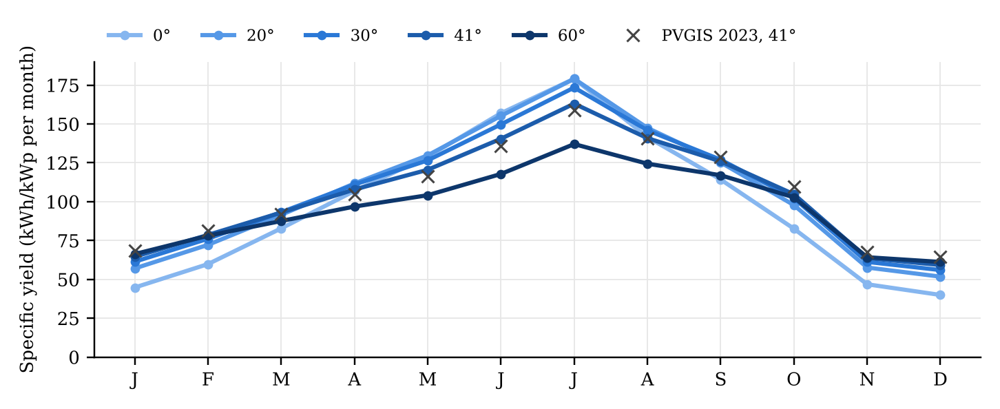
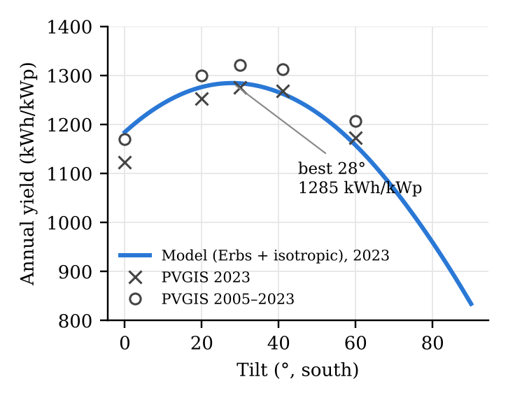
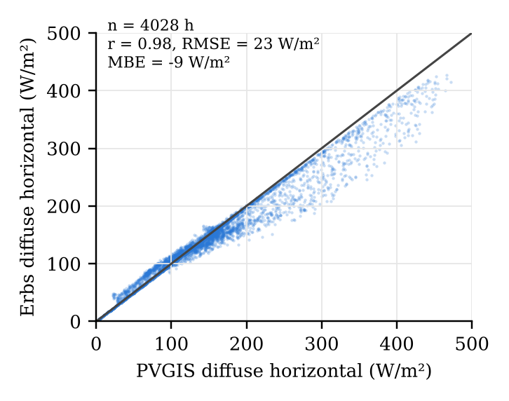
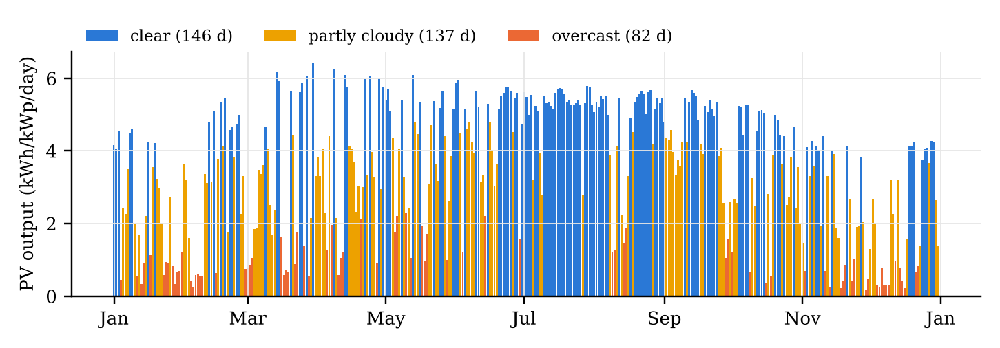
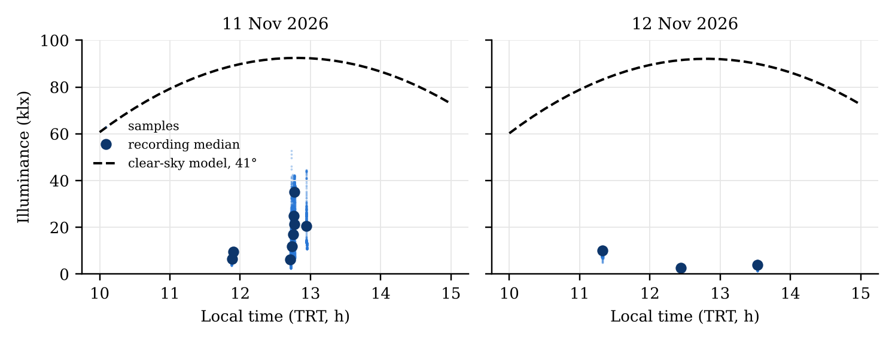

# Rooftop Solar Power for İstanbul Homes

Hourly modelling of a **5 kWp south-facing rooftop PV system in İstanbul** from one year (2023) of
PVGIS 5.3 satellite data, with the Erbs diffuse-fraction model, the isotropic-sky (Liu–Jordan)
transposition model and a NOCT temperature correction. Results are validated against the official
PVGIS PV estimates and compared with smartphone light-sensor (phyphox) measurements. The project
also covers the loss on cloudy days and a simple payback analysis with the current EPDK household tariff.



## Key results (2023, İTÜ Ayazağa campus, 41.105° N, 29.025° E)

| Tilt (south) | Irradiation on panel (kWh m⁻²) | Model yield (kWh kWp⁻¹) | Capacity factor | PVGIS 2023 (kWh kWp⁻¹) | Model − PVGIS |
|---|---|---|---|---|---|
| 0°  | 1455 | 1185 | 13.5 % | 1123 | +5.5 % |
| 20° | 1578 | 1277 | 14.6 % | 1252 | +1.9 % |
| 30° | 1588 | 1284 | 14.7 % | 1275 | +0.7 % |
| 41° | 1559 | 1263 | 14.4 % | 1269 | −0.5 % |
| 60° | 1418 | 1158 | 13.2 % | 1173 | −1.3 % |

- **Best tilt:** 28° in the model (PVGIS 2005–2023 optimum 32°). The “tilt = latitude” rule (41°) loses 1.7 %.
- **5 kWp at 30°:** ≈ 6 420 kWh per year.
- **Clouds:** an overcast day gives on average 83 % less than a clear day of the same month; clouds removed 32 % of the clear-sky potential in 2023.
- **Erbs vs PVGIS diffuse (hourly):** r = 0.98, RMSE = 23 W m⁻², bias −9 W m⁻².
- **Simple payback** (EPDK tariff of 4 Apr 2026, 3.24–4.86 TL kWh⁻¹ incl. taxes; 150 000–210 000 TL investment): 4.8–10.1 years, central case 5.8–8.7 years.
- **Phone measurements** (11–12 Nov 2026, cloudy days, around noon): measured / clear-sky irradiance = 0.03–0.38, consistent with the PVGIS cloudy-day ratios.

| | |
|---|---|
|  |  |
|  |  |

## Method

1. **Sun geometry** – declination, equation of time and hour angle (Spencer series); checked against the PVGIS sun height (max. difference 0.3°).
2. **Erbs et al. (1982)** – hourly clearness index *k*ₜ = GHI / G₀ₕ → diffuse fraction *k*_d → DHI and DNI (all diffuse below 5° sun height).
3. **Isotropic sky (Liu & Jordan, 1963)** – G_POA = DNI·max(cos θ, 0) + DHI(1 + cos β)/2 + ρ·GHI(1 − cos β)/2, ρ = 0.2.
4. **PV output** – T_c = T_air + (NOCT − 20)/800 · G_POA (NOCT = 45 °C); P = 5 kWp · G_POA/1000 · [1 − 0.004 (T_c − 25)] · (1 − 0.14).
5. **Cloudy days** – daily clearness index K_T (clear ≥ 0.60, overcast < 0.30) applied to the PVGIS daily PV output at 41°.
6. **Economics** – simple payback = investment / (annual energy × tariff incl. taxes).
7. **Phone check** – phyphox illuminance converted with ≈ 110 lx per W m⁻² and compared with a Haurwitz clear-sky model on a 41° plane.

## Repository structure

```
data/
  pvgis/      PVGIS 5.3 hourly data (2023) and PV benchmarks (retrieved 11 Nov 2026)
  phyphox/    raw phyphox "Light" recordings (11–12 Nov 2026)
src/
  config.py           paths and site coordinates
  fetch_pvgis.py      re-download the PVGIS inputs (internet needed)
  model.py            Erbs + isotropic sky + temperature model, cloudy-day loss, economics
  phone_analysis.py   phyphox parsing and clear-sky comparison
  figures.py          figures 1–5
  build_workbook.py   Excel workbook with live formulas (≈190 000 formulas)
  build_report.py     report (.docx)
  build_letter.py     one-page recommendation letter to the İstanbul Governorship (.docx)
outputs/
  report.pdf / report.docx, workbook.xlsx, letter_istanbul_governorship.pdf / .docx
  figures/*.png, *.csv summaries
```

## How to run

```bash
pip install -r requirements.txt
cd src
python fetch_pvgis.py        # optional: data are already included
python model.py
python phone_analysis.py
python figures.py
python build_workbook.py     # formulas are recalculated when the file is opened in Excel/LibreOffice
python build_report.py
python build_letter.py
# optional PDF export (LibreOffice):
soffice --headless --convert-to pdf --outdir ../outputs ../outputs/report.docx ../outputs/letter_istanbul_governorship.docx
```

or simply `bash run_all.sh` from the repository root.

## Data sources

- European Commission, Joint Research Centre (2026). **PVGIS 5.3** – PVGIS-SARAH3 irradiance, ERA5 temperature and wind. https://re.jrc.ec.europa.eu/pvg_tools/en/
- **EPDK** – electricity tariff tables valid from 4 April 2026 (Board Decision 14461, Resmî Gazete 33214). https://www.epdk.gov.tr/Detay/Icerik/3-1327/elektrik-faturalarina-esas-tarife-tablolari
- Milliyet Uzmanpara (2026) – 2026 market cost range for a 5 kW home PV system.
- İBB AKOM (2026) – İstanbul weekly forecast, 8–13 November 2026.

## Limitations

- One year of data (2023 was ≈3 % below the 2005–2023 PVGIS mean); nine daytime hours are missing in the PVGIS file.
- No reflection (angle-of-incidence), spectral or low-light losses; the NOCT model ignores wind.
- The phone readings cover two **cloudy** days around noon only (11:19–13:31 on 12 Nov; 11:52–12:57 on 11 Nov); the sensor is uncalibrated and the tilt was held by hand. A clear day with hourly readings from 10:00 to 15:00 would complete the comparison.
- The payback is a simple (undiscounted) payback with a fixed tariff.

## References

- Duffie, J. A., & Beckman, W. A. (2013). *Solar Engineering of Thermal Processes* (4th ed.). Wiley.
- Erbs, D. G., Klein, S. A., & Duffie, J. A. (1982). *Solar Energy*, 28(4), 293–302.
- Huld, T., Müller, R., & Gambardella, A. (2012). *Solar Energy*, 86(6), 1803–1815.
- Liu, B. Y. H., & Jordan, R. C. (1963). *Solar Energy*, 7(2), 53–74.

## License

Code: MIT (see `LICENSE`). PVGIS data © European Union, reused under the European Commission reuse policy with acknowledgement of the source.
